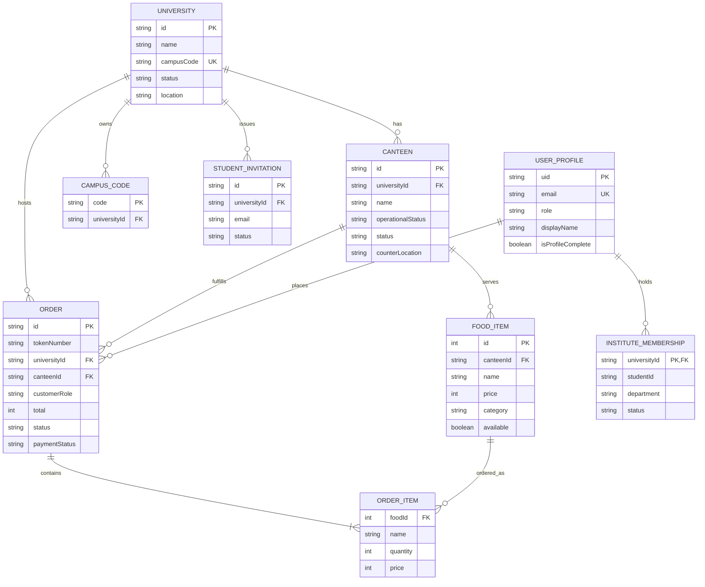

# Ubiquitous Language: BUNK N BITE

**Project:** BUNK N BITE — Multi-Campus Dining & Canteen Management Platform
---

### Project & Team Details

| Team Member                |  Student ID  | 
| :------------------------- | :-----------: |
| **Yash Gangwani**    | `202512048` | 
| **Divyesh Dandwani** | `202512043` | 
| **Vivek Dhanwani**   | `202512045` | 

- **Architecture:** Multi-Tenant Shared Database (Firebase Realtime Database & Authentication, TanStack Start / React)
- **Document Purpose:** Canonical reference for domain terms, user roles, business rules, and system workflows.

---

## Table of Contents

- [A. Project Overview](#a-project-overview)
- [B. Core Domain Concepts](#b-core-domain-concepts)
- [C. Ubiquitous Language Glossary](#c-ubiquitous-language-glossary)
- [D. Actors and Their Responsibilities](#d-actors-and-their-responsibilities)
- [E. Business Processes and Workflows](#e-business-processes-and-workflows)
- [F. Business Rules and Constraints](#f-business-rules-and-constraints)
- [G. Domain Relationships and ER Diagram](#g-domain-relationships-and-er-diagram)
- [H. Domain Events and State Transitions](#h-domain-events-and-state-transitions)
- [I. Naming Conventions](#i-naming-conventions)
- [J. Flagged Terminology Ambiguities](#j-flagged-terminology-ambiguities)
- [K. Implementation Gaps and Open Questions](#k-implementation-gaps-and-open-questions)

---

## A. Project Overview

**BUNK N BITE** is a web-based campus food ordering and canteen management system. It solves the common problem of crowded food counters during short class breaks ("bunks" or recess). It lets students and visitors pre-order food and pick it up using a token number, while canteens manage orders through a live kitchen display.

### Multi-Tenant Shared Database Architecture

The application uses a **single shared Firebase Realtime Database** for all universities and canteens. Data is logically separated instead of using separate databases for each campus:

- **University Tenant Level:** Each university has a unique `universityId` and a 6-character `campusCode`.
- **Canteen Sub-Tenant Level:** Each food outlet belongs to a university and has its own `canteenId`.
- **Tenant Isolation:** Data access is restricted in two ways:
  1. *Frontend State:* Filtered by `selectedUniversityId` and `selectedCanteenId`.
  2. *Firebase Security Rules (`database.rules.json`):* Rules check the user's role and assigned `universityId` so university admins cannot edit data from another campus.

---

## B. Core Domain Concepts

Concepts are labeled as **[Implemented]** (exists in the code) or **[Proposed]** (planned for future versions).

### 1. Campus & Administration

- **University [Implemented]:** An institution registered on the platform. It has an `id`, name, location, contact details, status (`Active`, `Review`, `Inactive`), and an assigned `campusCode`.
- **Campus Code [Implemented]:** A unique 6-character code (e.g., `AHMD24`) generated when a university is approved. Canteens use this code to register under that campus.
- **University Request [Implemented]:** An onboarding request submitted by a university representative. It starts as `Pending` and can be marked `Review`, `Approved`, or `Rejected` by the Owner Admin.

### 2. Canteens & Menus

- **Canteen [Implemented]:** A food stall operating on a campus. It has an `id`, `universityId`, owner contact, counter location, kitchen status (`Open`, `Busy`, `Closed`), and an administrative `operationalStatus` (`Active` or `Suspended`).
- **Canteen Request [Implemented]:** An onboarding form filled by a canteen vendor using a valid campus code. Approved or rejected by the University Admin.
- **Operational Status [Implemented]:** An administrative control managed by the University Admin. If a canteen is set to `Suspended`, students and visitors cannot place orders from it.
- **Food Item [Implemented]:** A dish or drink offered by a canteen. It includes `id` (numeric timestamp), `canteenId`, `name`, `price`, `category`, prep time, description, dietary tag (`isVeg`), and an `available` toggle.
- **Category [Implemented]:** One of five fixed food categories: `Breakfast`, `Snacks`, `Meals`, `Drinks`, or `Desserts`.
- **Cart / Tray [Implemented]:** A temporary in-browser list of food items and quantities before checkout.

### 3. Orders & Payments

- **Order [Implemented]:** A food order placed by a student or visitor. Contains the items, customer name/role, pickup counter, subtotal, 5% platform tax, total, `status`, `paymentMethod`, `paymentStatus`, and a `tokenNumber`.
- **Token Number [Implemented]:** A short identifier (e.g., `TK-48`) assigned to each order so the kitchen can call out when the food is ready.
- **Order Status [Implemented]:** Tracks order progress: `Placed` $\rightarrow$ `Preparing` $\rightarrow$ `Ready` $\rightarrow$ `Completed` (or `Cancelled`).
- **Platform Tax [Implemented]:** A 5% platform service charge added to the cart subtotal (`Math.round(cartSubtotal * 0.05)`).
- **Payment Simulation [Implemented]:** In the current version, payment selection (UPI, Card, Net Banking) simulates payment verification in the UI and marks the order as `Paid`. *(An external payment gateway is planned).*

### 4. Users & Multi-Campus Memberships

- **User Profile [Implemented]:** Stored in `/users/{uid}`, holding `displayName`, `email`, `role`, and account status.
- **Institute Membership [Implemented]:** A user profile record (`instituteMemberships/{univId}`) linking a student to a university. This lets a student belong to more than one campus with separate student IDs and departments.
- **Student Invitation [Implemented]:** A record created in `/studentInvitations` when an admin adds an email that does not have an account yet.
- **Visitor [Implemented]:** A walk-in customer who scans a canteen QR code. Visitors do not need an account, but must pay online at checkout.

### 5. Messaging & Future Concepts

- **Mail Queue (`mailQueue`) [Implemented]:** A database list of outgoing welcome and invitation emails, processed via backend Nodemailer.
- **Automated Refund [Proposed]:** Automatically returning money when an online order is cancelled.
- **Live Payment Gateway [Proposed]:** Real Razorpay/Paytm payment processing with webhooks.

---

## C. Ubiquitous Language Glossary

| Term | Definition | Aliases to avoid | Named in code at |
|---|---|---|---|
| **Order** | A confirmed commercial transaction for one or more food items placed by a student or visitor, identified by a token number. | Booking, Ticket, Invoice, Bill | Model `Order` in `src/features/bunk/types.ts`, DB path `/orders/{id}`, `orderService.ts`, `OrderTimeline.tsx` |
| **Order Item** | An individual food item and selected quantity within an order. | Cart Item, Order Line, Sub-item | Interface `OrderItem` in `src/features/bunk/types.ts`, `Order.items` |
| **Token Number** | A human-readable pickup identifier (e.g., `TK-48`) generated at checkout for counter pickup callout. | Queue Number, Slip Number, Token ID | `Order.tokenNumber` in `src/features/bunk/types.ts`, `processPaymentAndOrder()` in `state.tsx` |
| **Food Item** | A dish, beverage, or packaged food product sold by a canteen, with price, category, and real-time availability. | Menu Item, Dish, Product, SKU | Model `FoodItem` in `src/features/bunk/types.ts`, DB path `/foods/{id}`, `menuService.ts`, `FoodCard.tsx` |
| **Menu** | The complete collection of food items offered by a specific canteen stall. | Catalog, Price List, Inventory | `menuService.ts`, `foods` state in `src/features/bunk/state.tsx`, `CanteenView.tsx` |
| **Category** | One of five fixed food classifications: Breakfast, Snacks, Meals, Drinks, or Desserts. | Section, Course, Food Type | `FoodItem.category` in `src/features/bunk/types.ts`, `FoodEmoji.tsx` |
| **Available** | A live boolean flag indicating whether a food item is currently in stock and can be prepared by the kitchen. | In Stock, Active, Enabled | `FoodItem.available` in `src/features/bunk/types.ts`, `toggleFoodAvailabilityInDb()` in `menuService.ts` |
| **Cart** | The client-side tray holding selected food items and quantities before checkout. | Tray (in code/state), Basket, Bag | `cart` in `src/features/bunk/state.tsx`, `CartItem` in `types.ts`, `CartDrawer.tsx` |
| **Canteen** | A food preparation counter, cafeteria stall, or dining hall on a campus. | Outlet, Restaurant, Shop, Stall | Model `Canteen` in `src/features/bunk/types.ts`, DB path `/canteens/{id}`, `canteenService.ts`, `CanteenView.tsx` |
| **Canteen Request** | An application submitted by a food vendor using a valid campus code to open a canteen stall. | Vendor Application, Stall Request | Model `CanteenRequest` in `src/features/bunk/types.ts`, DB path `/canteenRequests/{id}`, `AuthModal.tsx` |
| **Operational Status** | Administrative permission status (`Active` or `Suspended`) set exclusively by the University Admin to enable or block customer orders. | Canteen Status, License State | `Canteen.operationalStatus` in `src/features/bunk/types.ts`, `toggleCanteenOperationalStatusInDb()` in `canteenService.ts` |
| **University** | An accredited higher education institution or campus registered as a top-level tenant. | Institute, College, Campus (as tenant), Organization | Model `University` in `src/features/bunk/types.ts`, DB path `/universities/{id}`, `universityService.ts`, `UniversityView.tsx` |
| **Campus Code** | A unique 6-character uppercase code (e.g., `AHMD24`) used by vendors and students to link to an approved university. | Join Code, Promo Code, Secret Key | DB path `/campusCodes/{code}`, `University.campusCode` in `types.ts`, `reserveUniqueCampusCode()` in `universityService.ts` |
| **University Request** | An institutional inquiry submitted by a campus representative seeking onboarding on the platform. | Campus Application, Partner Inquiry | Model `UniversityRequest` in `src/features/bunk/types.ts`, DB path `/universityRequests/{id}`, `OwnerView.tsx` |
| **Institute Membership** | A student profile record linking an authenticated user to a specific university, holding student ID, department, and campus status. | Campus Membership, Roster Link, Pass | Interface `InstituteMembership` in `src/features/auth/types.ts`, DB path `/users/{uid}/instituteMemberships/{univId}` |
| **Student Invitation** | A pending enrollment record for an unregistered student email added via single or bulk Excel upload. | Pre-enrollment, Student Lead | Interface `StudentInvitation` in `src/features/auth/types.ts`, DB path `/studentInvitations/{id}`, `studentService.ts` |
| **Student ID** | The university-issued roll number or student identifier. | Roll Number, Enrollment Number (in code/models) | `StudentUser.studentId`, `InstituteMembership.studentId`, `UniversityStudentMember.studentId` in `types.ts` |
| **Payment** | The digital settlement step (UPI, Cards, Net Banking) required to confirm an order. | Checkout, Transaction | `Order.paymentMethod`, `Order.paymentStatus`, `processPaymentAndOrder()` in `state.tsx` |
| **Platform Tax** | A uniform 5% platform service charge added to the food subtotal. | GST, Surcharge, Delivery Fee, Tip | `Order.platformTax` in `src/features/bunk/types.ts`, `cartTax` in `src/features/bunk/state.tsx` |
| **Counter QR Code** | A physical QR code at a canteen counter that visitors and students scan to directly load that specific canteen's menu. | Table Barcode, UPI QR, Payment QR | `VisitorView.tsx`, `Header.tsx` |
| **Owner Admin** | Highest platform administrator with oversight across all universities, requests, and platform metrics. | Superadmin, Master, Root | Role `"owner"` in `src/features/bunk/types.ts`, `OwnerView.tsx`, `database.rules.json` |
| **University Admin** | Campus administrator who manages canteens, student rosters, and canteen operational suspensions for their campus. | Campus Admin, Institute Admin, Principal | Role `"university"` in `src/features/bunk/types.ts`, `UniversityView.tsx`, `database.rules.json` |
| **Canteen Owner** | Kitchen vendor managing menus, live dish availability, and order preparation for one canteen. | Caterer, Chef, Stall Manager | Role `"canteen"` in `src/features/bunk/types.ts`, `CanteenView.tsx`, `database.rules.json` |
| **Student** | Enrolled university member authenticated on the platform with privileges to pre-order food and track order tokens. | Scholar, Customer, Client | Role `"student"` in `src/features/bunk/types.ts`, `StudentView.tsx`, `StudentUser` in `types.ts` |
| **Visitor** | Guest diner who scans a counter QR code and orders without creating an account; must pay online upfront. | Guest, Walk-in, Anonymous User | Role `"visitor"`, `Order.customerRole` (`"Visitor"`), `VisitorView.tsx` |

---

## D. Actors and Their Responsibilities

```
                         +-------------------+
                         |    Owner Admin    |
                         +---------+---------+
                                   | (Approves & assigns Campus Code)
                         +---------v---------+
                         | University Admin  |
                         +---------+---------+
                                   | (Approves canteens & manages students)
                         +---------v---------+
                         |   Canteen Owner   |
                         +---------+---------+
                                   | (Prepares food & updates orders)
                        +----------+----------+
                        |                     |
              +---------v---------+ +---------v---------+
              |      Student      | |      Visitor      |
              +-------------------+ +-------------------+
```

### 1. Owner Admin

- **Role Code:** `owner`
- **Scope:** Global across all universities.
- **Responsibilities:**
  - Approves or rejects university onboarding requests.
  - Generates the unique 6-character `campusCode` for newly approved universities.
  - Can view platform-wide order totals, active canteen counts, and database seeds.
- **Permissions:** Full read/write access to universities, campus codes, and university requests.
- **Restrictions:** Does not manage daily kitchen menus or fulfill orders.

### 2. University Admin

- **Role Code:** `university`
- **Scope:** Restricted to their assigned `universityId`.
- **Responsibilities:**
  - Approves or rejects canteen vendor requests for their campus.
  - Can suspend or reactivate canteens if there are hygiene or compliance issues.
  - Adds students individually or in bulk via Excel (`.xlsx`) files.
  - Can suspend or reactivate student campus access.
- **Permissions:** Reads and modifies canteens, student memberships, and invitations for their campus.
- **Restrictions:** Cannot view or edit records from other universities.

### 3. Canteen Owner

- **Role Code:** `canteen`
- **Scope:** Restricted to their specific `canteenId`.
- **Responsibilities:**
  - Adds, edits, and removes food items from their menu.
  - Toggles item availability on and off when stock runs out.
  - Advances orders through the kitchen workflow: `Placed` $\rightarrow$ `Preparing` $\rightarrow$ `Ready` $\rightarrow$ `Completed`.
  - Cancels orders if items cannot be prepared.
- **Permissions:** Manages their own foods and orders.
- **Restrictions:** Cannot override an operational suspension placed by the university.

### 4. Student

- **Role Code:** `student`
- **Scope:** Authenticated campus user.
- **Responsibilities:**
  - Browses menus of open canteens on campus.
  - Adds items to cart, chooses payment method, and places pre-orders.
  - Tracks live order status and presents token number at pickup.
  - Completes profile details (Full Name, Roll Number).
- **Permissions:** Reads campus menus; creates orders; edits own user profile.
- **Restrictions:** Cannot order from suspended canteens; cannot modify menu prices or order status.

### 5. Visitor

- **Role Code:** `visitor`
- **Scope:** Temporary guest dining via counter QR code.
- **Responsibilities:**
  - Scans canteen QR code to view that specific stall's menu.
  - Adds items to cart.
  - **Payment Rule:** Must pay online upfront at checkout. Cash and deferred campus accounts are not allowed.
  - Shows the generated pickup token on their phone at the counter.
- **Permissions:** Reads public menu items; creates guest orders marked `Paid`.
- **Restrictions:** No account history saved; cannot access student discounts.

---

## E. Business Processes and Workflows

### 1. University Onboarding and Approval

1. **Submission:** A university contact fills out the onboarding form in the app.
2. **Review:** The request is saved to `/universityRequests` as `Pending`.
3. **Approval:** The Owner Admin reviews it in `OwnerView` and clicks "Approve".
4. **Code Generation:** The system picks a random 6-character code (avoiding confusing letters like O, 0, I, 1) and reserves it in `/campusCodes`.
5. **Activation:** A new `University` record is saved in `/universities` with status `Active`.

### 2. Canteen Onboarding

1. **Application:** A vendor signs up using the university's 6-character `campusCode`.
2. **Code Check:** The system verifies the code. If valid, it saves a `CanteenRequest` as `Pending`.
3. **Approval:** The University Admin reviews the request in `UniversityView` and approves it.
4. **Creation:** A new `Canteen` entry is created with `operationalStatus: "Active"` and `status: "Open"`.

### 3. Student Registration & Authentication

Students can join in three ways:

- **Email & Password:** Normal sign-up in the app. Default role is always `student`.
- **Google Sign-In:** One-click Google login. Profile is created automatically.
- **Email Link (Passwordless):** Used when invited by an admin. The student clicks a link in their email to log in without a password.

### 4. Student Bulk Onboarding via Excel

1. **Upload:** University Admin downloads the sample template and uploads an `.xlsx` file (max 5MB).
2. **Validation:** The system normalizes column headers (`Email`, `Name`, `Student ID`, `Department`) and checks for valid email format and duplicates.
3. **Existing Users:** If an email already has an account, the university membership is added to their profile, and a welcome email is queued.
4. **New Users:** If the email is new, a `StudentInvitation` is saved as `pending`, and an invite email with a sign-in link is queued.

### 5. Profile Completion for Invited Students

1. When an invited student signs in via their email link, any pending invitations for their email are marked `accepted`.
2. If their profile name is missing, the `ProfileCompletionModal` pops up.
3. The student enters their full name and student ID, and can optionally set a password.

### 6. Visitor QR Ordering

1. A visitor scans the QR code at a canteen counter.
2. The app opens `VisitorView` locked to that canteen.
3. The visitor adds food items to their tray and proceeds to Checkout.
4. **Online Payment:** The visitor must choose UPI, Card, or Net Banking.
5. Once payment is confirmed, the order is created with `customerRole: "Visitor"` and a token number is shown.

### 7. Menu & Stock Management

1. Canteen Owner clicks "Add Item" in `CanteenView` and fills in dish details, price, category, and prep time.
2. The item is saved under `/foods/{foodId}`.
3. When an item runs out during the day, the owner toggles the `Available` switch off. It immediately disappears from customer carts.

### 8. Order Processing and Pickup

```
[Customer adds to Tray] 
        │
        ▼
[Pre-checkout Check: Canteen Active? Items in Stock?] 
        │
        ▼
[Order Placed + Token Generated (e.g., TK-48)]
        │
        ▼
[Kitchen Marks: Preparing] ──► [Kitchen Marks: Ready] ──► [Customer Picks Up: Completed]
        │
        └── (If items unavailable) ──► [Cancelled]
```

1. Customer reviews tray and taps "Pay & Order".
2. System verifies items are available and recalculates totals.
3. Order is saved as `Placed` with a pickup token (e.g., `TK-48`).
4. Kitchen sees the order in real time and moves it to `Preparing`.
5. Once cooked, staff clicks "Mark Ready".
6. The customer shows their token at the counter and collects the food. Staff marks the order `Completed`.

---

## F. Business Rules and Constraints

### 1. Multi-Tenant Separation

- **Tenant Key:** All canteens, requests, and student memberships must include a `universityId`.
- **Security Rule:** A University Admin can only read or edit data where `universityId` matches their own campus.
- **Unique Codes:** Campus codes must be unique across the entire system.

### 2. Role Permissions (RBAC)

- **Safe Defaults:** All self-registered users are assigned the `student` role.
- **No Self-Promotion:** Firebase rules prevent users from changing their own role in the database.
- **Owner Admin:** Only owner admins can approve universities.
- **Canteen Owners:** Can only edit menu items and orders that belong to their `canteenId`.

### 3. Canteen Suspension Rules

- **Admin Control:** Only the University Admin can suspend a canteen.
- **Order Lockout:** If a canteen is `Suspended`, no student or visitor can check out orders from that canteen.

### 4. Ordering & Payment Rules

- **Mandatory Online Payment for Visitors:** Visitors cannot place unpaid or cash orders.
- **Out of Stock Lock:** Sold-out items (`available: false`) cannot be added to a cart or ordered.
- **Platform Tax:** A uniform 5% platform fee is added to every order.
- **Order States:** Orders can only move forward in the lifecycle (`Placed` $\rightarrow$ `Preparing` $\rightarrow$ `Ready` $\rightarrow$ `Completed`). Once completed or cancelled, they cannot be reopened.

### 5. Student Enrollment Rules

- **Account Protection:** Removing a student from a university removes only their `instituteMemberships` record for that campus. Their main account is never deleted.
- **File Validation:** Bulk upload spreadsheets must be under 5MB and must contain valid email addresses.

---

## G. Domain Relationships and ER Diagram



---

## H. Domain Events and State Transitions

In BUNK N BITE, domain events represent key state changes in the database that trigger real-time updates across user interfaces.

### 1. State Transitions

- **University Request:** `Pending` $\rightarrow$ `Review` $\rightarrow$ `Approved` (generates Campus Code) OR `Rejected`
- **Canteen Request:** `Pending` $\rightarrow$ `Approved` (creates active canteen) OR `Rejected`
- **Canteen Operational Status:** `Active` $\longleftrightarrow$ `Suspended` *(When suspended, customer checkout for this stall is blocked)*
- **Order Lifecycle:** `Placed` $\rightarrow$ `Preparing` $\rightarrow$ `Ready` $\rightarrow$ `Completed` *(At any point before completion, an order can be marked `Cancelled`)*
- **Student Invitation:** `pending` $\rightarrow$ `accepted` (when student signs in) OR `cancelled`
- **Mail Queue:** `queued` $\rightarrow$ `sent` OR `failed`

### 2. Implemented Domain Events

- **`UniversityApproved`:** Owner Admin approves request; a 6-character campus code is reserved.
- **`CanteenApproved`:** University Admin approves a vendor request; canteen record is created.
- **`CanteenSuspended / CanteenReactivated`:** University Admin toggles operational status.
- **`StudentInvited`:** Single or bulk upload creates an invitation and queues an email.
- **`FoodAvailabilityChanged`:** Canteen owner flips the available switch on a dish.
- **`OrderPlaced`:** Customer finishes checkout; order is saved and token is assigned.
- **`OrderStatusChanged`:** Canteen advances order status (e.g., marks ready for pickup).

### 3. Proposed Events

- **`OrderRefunded` [Proposed]:** Automatically triggers a refund when an order is cancelled.
- **`DailySettlementCalculated` [Proposed]:** End-of-day revenue summary for canteens and universities.

---

## I. Naming Conventions

To keep code clean and consistent across our team, we follow these standard names:

| Concept                | Database Path                                  | TypeScript Type         | Service File             | Frontend View                       |
| :--------------------- | :--------------------------------------------- | :---------------------- | :----------------------- | :---------------------------------- |
| **University**   | `/universities/{id}`                         | `University`          | `universityService.ts` | `UniversityView`, `OwnerView`   |
| **Campus Code**  | `/campusCodes/{code}`                        | `string`              | `universityService.ts` | `AuthModal`                       |
| **Canteen**      | `/canteens/{id}`                             | `Canteen`             | `canteenService.ts`    | `CanteenView`, `UniversityView` |
| **Food Item**    | `/foods/{id}`                                | `FoodItem`            | `menuService.ts`       | `FoodCard`, `CanteenView`       |
| **Order**        | `/orders/{id}`                               | `Order`               | `orderService.ts`      | `CartDrawer`, `StudentView`     |
| **User Profile** | `/users/{uid}`                               | `UserProfile`         | `authService.ts`       | `Header`, `AuthModal`           |
| **Membership**   | `/users/{uid}/instituteMemberships/{univId}` | `InstituteMembership` | `studentService.ts`    | `UniversityView`                  |
| **Invitation**   | `/studentInvitations/{id}`                   | `StudentInvitation`   | `studentService.ts`    | `BulkImportModal`                 |

## J. Flagged Terminology Ambiguities

This section resolves naming conflicts identified in the codebase. For each ambiguity, we identify the conflicting terms, their locations, the reason for confusion, and the canonical term that wins.

### 1. University vs. Campus
- **Conflicting Terms:** `University` vs. `Campus`
- **Where Used in Code:**
  - `University`: Model `University` in `src/features/bunk/types.ts`, database path `/universities/{id}`, state `selectedUniversityId` in `src/features/bunk/state.tsx`, component `UniversityView.tsx`.
  - `Campus`: Property `campusCode` in `src/features/bunk/types.ts`, database path `/campusCodes/{code}`, property `campusLocation` in `UniversityRequest`, UI text "Campus User", "Campus Canteen", and "Onboard Campus" in `AuthModal.tsx`.
- **Why It Is Confusing:** Team members mix up whether an entity represents the institution (organization) or its geographical grounds, leading to inconsistent naming such as `campusId` vs. `universityId` and `selectedCampus` vs. `selectedUniversity`.
- **Canonical Term:** **University** wins as the canonical term for the tenant entity and all database foreign keys (`universityId`, `/universities`). **Campus Code** is reserved strictly as a compound noun for the 6-character onboarding token (`campusCode`, `/campusCodes`).
- **Winner:** `University` wins for tenancy and entity modeling; `Campus Code` wins for the join key.

### 2. Food Item vs. Menu Item
- **Conflicting Terms:** `Food Item` (`FoodItem`) vs. `Menu Item`
- **Where Used in Code:**
  - `Food Item`: TypeScript model `FoodItem` in `src/features/bunk/types.ts`, database path `/foods/{id}`, state `foods` in `src/features/bunk/state.tsx`, component `FoodCard.tsx`, helper `initialFoods` in `data.ts`.
  - `Menu Item`: Service messages and toasts in `src/features/menu/services/menuService.ts` ("Menu item updated", "add menu item"), UI navigation tab "Menu" and button "Add Menu Item" in `CanteenView.tsx`.
- **Why It Is Confusing:** The entity is named `FoodItem` in the data layer and stored under `/foods`, but frequently referred to as `Menu Item` in service messages and UI copy, creating doubt about whether new endpoints or types should be named `menuItems` or `foods`.
- **Canonical Term:** **Food Item** (`FoodItem` in models, `/foods` in database) wins for individual dish entities. **Menu** refers exclusively to the aggregated catalog of food items offered by a canteen.
- **Winner:** `Food Item` wins.

### 3. Canteen Status vs. Operational Status
- **Conflicting Terms:** `Canteen Status` (`status`) vs. `Operational Status` (`operationalStatus`)
- **Where Used in Code:**
  - `Canteen Status` (`status`): Property on `Canteen` in `src/features/bunk/types.ts` taking values `"Open" | "Busy" | "Closed"`. Controlled by Canteen Owner in `CanteenView.tsx`.
  - `Operational Status` (`operationalStatus`): Property on `Canteen` in `src/features/bunk/types.ts` taking values `"Active" | "Suspended"`. Mutated via `toggleCanteenOperationalStatusInDb()` in `canteenService.ts` by University Admin.
- **Why It Is Confusing:** Both fields use the word "status" on the same `Canteen` entity. A canteen can simultaneously be kitchen-`Open` while administratively-`Suspended`, or kitchen-`Closed` while administratively-`Active`. Shortening `operationalStatus` to `status` in conversations or code causes critical checkout and access control bugs.
- **Canonical Term:** **Operational Status** (`operationalStatus`) wins for university administrative authority (`Active` vs. `Suspended`). Daily kitchen availability must be explicitly referred to as **Kitchen Status** (stored in `status` with values `Open`, `Busy`, `Closed`).
- **Winner:** `Operational Status` wins for administrative licensing; `Kitchen Status` wins for daily shift readiness.

### 4. Cart vs. Tray vs. Order
- **Conflicting Terms:** `Cart` vs. `Tray` vs. `Order`
- **Where Used in Code:**
  - `Cart`: State in `src/features/bunk/state.tsx` (`cart`, `cartCount`, `cartSubtotal`, `cartTax`, `cartTotal`), interface `CartItem` in `src/features/bunk/types.ts`, component `CartDrawer.tsx`.
  - `Tray`: User interface buttons and messages in `VisitorView.tsx` ("Tray (2)", "Your tray is empty", "remove it from your tray") and `StudentView.tsx`.
  - `Order`: Confirmed purchase entity stored under `/orders/{id}` with assigned token number.
- **Why It Is Confusing:** Pre-checkout items are called "Cart" in technical architecture and state, but "Tray" in the user interface. Developers might mistakenly introduce a `Tray` entity or `tray` state variable, or confuse pre-checkout cart items with placed order items.
- **Canonical Term:** **Cart** wins for all code, types, state variables, and architectural documentation (`cart`, `CartItem`, `CartDrawer`). **Tray** is acceptable only as user-facing UI copy for students and visitors. **Order** is reserved strictly for finalized, placed purchases.
- **Winner:** `Cart` wins in code and architecture.

### 5. User Role vs. Customer Role
- **Conflicting Terms:** `User Role` (`role`) vs. `Customer Role` (`customerRole`)
- **Where Used in Code:**
  - `User Role` (`role`): Stored at `/users/{uid}/role` and typed in `src/features/bunk/types.ts` as lowercase: `"owner" | "university" | "canteen" | "student" | "visitor"`.
  - `Customer Role` (`customerRole`): Stored at `/orders/{orderId}/customerRole` and typed in `src/features/bunk/types.ts` as capitalized: `"Student" | "Visitor"`.
- **Why It Is Confusing:** The naming and casing discrepancy causes runtime comparison bugs. For example, `order.customerRole === user.role` evaluates to `false` when comparing `"Student"` to `"student"`.
- **Canonical Term:** **User Role** (`role`) wins as the authoritative authentication and access tier. On orders, `customerRole` must be normalized to lowercase in future code cleanups.
- **Winner:** `User Role` wins.

### 6. Student ID vs. Roll Number
- **Conflicting Terms:** `Student ID` (`studentId`) vs. `Roll Number` (`rollno`)
- **Where Used in Code:**
  - `Student ID` (`studentId`): Model properties in `StudentUser.studentId`, `UniversityStudentMember.studentId`, `InstituteMembership.studentId`, and `/studentInvitations/{id}/studentId`.
  - `Roll Number` / `Roll No`: Header normalization alias in `src/features/students/utils/xlsxHelper.ts` (`rollno`, `enrollmentno`), UI label in `ProfileCompletionModal.tsx` ("Student ID / Roll No").
- **Why It Is Confusing:** Indian universities almost universally use the term "Roll Number" or "Enrollment Number", while developers implemented `studentId` in the schema.
- **Canonical Term:** **Student ID** (`studentId`) wins in all database schemas, models, and TypeScript types. "Roll Number" is treated strictly as an accepted spreadsheet import alias and UI helper label.
- **Winner:** `Student ID` wins.

### 7. Institute Membership vs. University Membership
- **Conflicting Terms:** `Institute Membership` (`InstituteMembership`) vs. `University Membership` (`universityMemberships`)
- **Where Used in Code:**
  - `Institute Membership`: TypeScript interface `InstituteMembership` in `src/features/auth/types.ts` and user profile path `/users/{uid}/instituteMemberships/{univId}`.
  - `University Membership`: Root database collection path `/universityMemberships/{universityId}/{uid}` and model `UniversityStudentMember`.
- **Why It Is Confusing:** The student profile uses "Institute" on its child path, while the database root collection uses "University". Developers writing queries are unsure which entity name represents the membership relationship.
- **Canonical Term:** **Institute Membership** represents the student's personal membership record attached to their profile. **University Membership** represents the campus-wide index. For future code standardization, "University Membership" is the canonical domain term.
- **Winner:** `University Membership` wins as the overarching domain concept.

---

## K. Implementation Gaps and Open Questions

These are genuine implementation gaps discovered in our code that the team needs to address:

1. **Active Campus Switcher for Students:**  
   Our database supports multi-campus memberships (`instituteMemberships`), but the student navbar currently lacks a quick dropdown to switch between campuses without logging out.
2. **University Admin Account Creation:**  
   When an Owner Admin approves a university request, the university record is created, but no user account is automatically assigned `role: "university"`. Right now, this has to be set manually in the database.
3. **Canteen Owner Profile Linking:**  
   When a canteen request is approved, the new `canteenId` is not automatically written back to the vendor's user profile. This must currently be linked manually.
4. **Real Payment Gateway Integration:**  
   The checkout currently simulates payment. Connecting an actual payment gateway (e.g., Razorpay) with server-side webhook verification is required before commercial rollout.
5. **Refund Handling on Order Cancellation:**  
   When a canteen cancels a placed order, the order is marked `Cancelled`, but there is no mechanism yet to refund the customer's money automatically.

---

*This document is the single source of truth for domain terms and business rules for the BUNK N BITE term project.*
